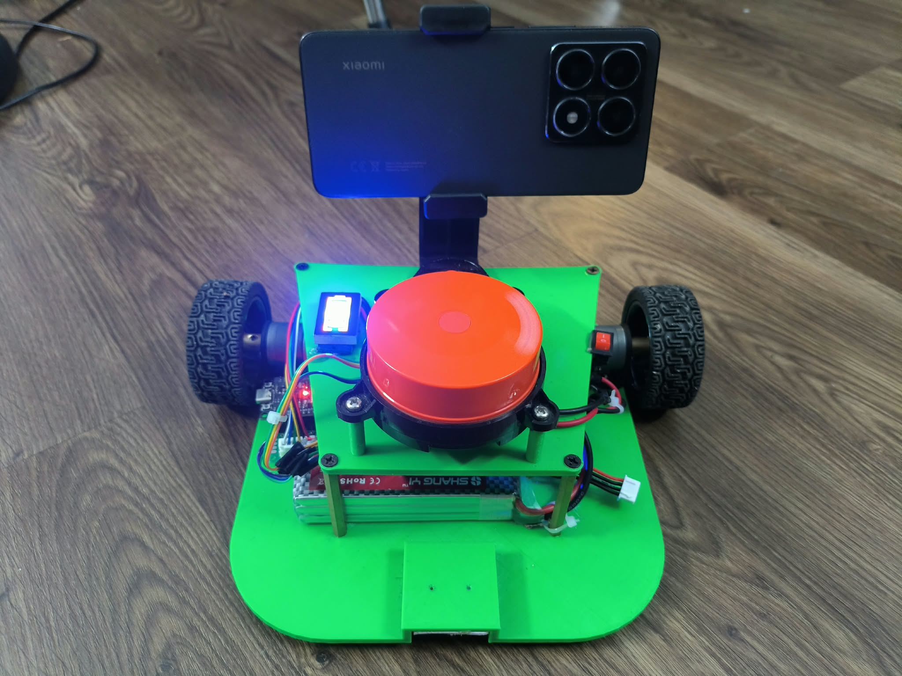
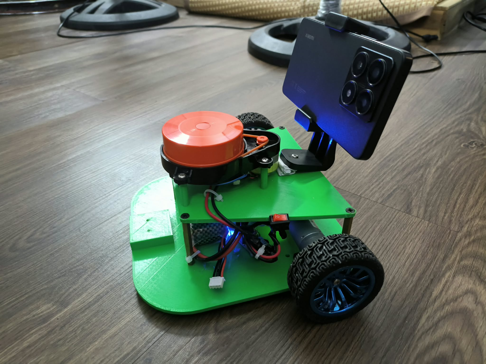
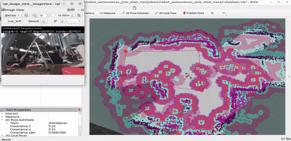
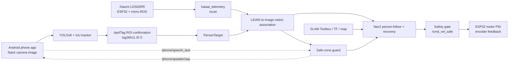

<div align="center">

# Robot FollowGuard

**Autonomous Person-Following and Safe-Zone Monitoring Robot**

<p>
  A ROS 2 mobile-robot prototype that confirms one person with an AprilTag,
  associates that person with 2D LiDAR measurements, follows through Nav2,
  and monitors a user-defined safe zone.
</p>

[](https://docs.ros.org/en/humble/)
[](https://www.python.org/)
[](https://docs.ultralytics.com/)
[](https://github.com/SteveMacenski/slam_toolbox)
[](https://navigation.ros.org/)
[](https://www.espressif.com/)

<p>
  
  
</p>

<a href="assets/readme/screen-demo.mp4">
  
</a>

</div>

> [!NOTE]
> **Prototype status.** This repository documents implemented software paths and
> configuration defaults. It does not claim measured accuracy, latency, FPS,
> obstacle-avoidance performance, or a formal safety guarantee.

> [!IMPORTANT]
> AprilTag is the sole public identity method in this repository. A person must
> carry `tag36h11`, ID `0`, and the tag must be visible inside exactly one YOLO
> person bounding box before following can start.

## Contents

- [Project Overview](#project-overview)
- [Highlights](#highlights)
- [System Architecture](#system-architecture)
- [How It Works](#how-it-works)
- [Hardware Architecture](#hardware-architecture)
- [Software Stack](#software-stack)
- [Installation](#installation)
- [Quick Start](#quick-start)
- [Experiments & Validation](#experiments--validation)
- [Known Limitations](#known-limitations)
- [Repository Structure](#repository-structure)
- [Related Projects & Acknowledgements](#related-projects--acknowledgements)
- [License](#license)

## Project Overview

Robot FollowGuard combines phone-camera person detection, AprilTag identity
confirmation, LiDAR geometry, SLAM Toolbox, Nav2, and a guarded velocity path
for one mobile-robot workflow. Camera data identifies a candidate; distance is
never estimated from the image. The metric target node projects fresh LiDAR
returns into the confirmed person's image bounding box before Nav2 receives a
follow target.

The system also exposes a safe-zone workflow: an operator supplies four map
points, the zone guard watches the confirmed target, announces an exit, and can
enter a guided return mode after a configured confirmation phrase. Details and
scope boundaries are in the [architecture guide](docs/architecture.md).

## Highlights

<table>
<tr>
<td width="50%" valign="top">

**Person Detection & Tracking**

- YOLOv8 detect-only person boxes and a lightweight IoU tracker.
- `tag36h11:0` confirmation only inside person ROIs.
- LiDAR points projected into the selected image box.
- Bounded Nav2 spin recovery after target loss.

</td>
<td width="50%" valign="top">

**Safe-Zone Monitoring**

- Four operator-selected map points define a polygon.
- LiDAR-based target position checks; camera is identity only.
- Configured Vietnamese voice-alert topics.
- Confirmation-gated guide-return behavior.

</td>
</tr>
<tr>
<td valign="top">

**SLAM & Autonomous Navigation**

- SLAM Toolbox and Nav2 launch integration.
- Camera-to-base TF and calibrated `CameraInfo` publisher.
- Obstacle-aware follow-goal updates from fresh scan data.
- Nav2 `/spin` action for bounded recovery search.

</td>
<td valign="top">

**Embedded Control & Safety**

- ESP32 firmware for LDS02RR telemetry, motor PID, and encoder feedback.
- micro-ROS transport and `kaiaai_telemetry` scan conversion.
- A safety gate requiring fresh scan data before forward motion.
- No direct recovery `/cmd_vel` path in the follower.

</td>
</tr>
</table>

## System Architecture

The [Android phone application](https://github.com/Hunggh06/jros2_cellphone_interface)
can publish the back-camera topic consumed here. Its README documents many
other sensors, but this repository directly configures only the back camera;
it also accepts `/phone/speech_text` and publishes `/phone/speaker/say` for the
safe-zone interaction. IMU use is not claimed by this follower source tree.



## How It Works

1. YOLO detects people in `/phone/camera/back/image`; a tracker maintains IDs.
2. The AprilTag detector scans only person crops. Exactly one valid configured
   tag inside exactly one box confirms the target.
3. Fresh `/scan`, `CameraInfo`, and TF data are associated with that target.
4. Nav2 receives an obstacle-aware follow goal when all validity gates pass.
5. On target loss, an existing Nav2 goal is allowed to finish first; then the
   follower uses bounded `/spin` recovery. Fresh person observations can pause
   the spin briefly for ROI tag inspection.
6. The zone guard evaluates the metric target against an operator-defined map
   polygon, publishes status, and uses configured speech topics for alerts.

Read the implementation-oriented [algorithms guide](docs/algorithms.md) for
state transitions and the [hardware guide](docs/hardware.md) for interfaces.

## Hardware Architecture

| Component | Role evidenced in this repository |
|---|---|
| ROS 2 Humble host | Runs perception, association, SLAM/Nav2, safety, and zone nodes. |
| Android phone | Supplies `/phone/camera/back/image`; may bridge configured speech topics. |
| ESP32 | Runs `firmware_esp32/robot.ino`: micro-ROS, LDS02RR telemetry, motor PID, encoders. |
| Xiaomi LDS02RR | UART LiDAR source decoded into `/scan` by `kaiaai_telemetry`. |
| Motors and encoders | JGA25-370 geared DC motors, rated at 240 RPM; receive RPM commands and produce firmware state feedback. |
| AprilTag marker | `tag36h11`, ID `0`; required for initial target confirmation. |

## Software Stack

| Layer | Implemented role |
|---|---|
| ROS 2 Humble / `colcon` | Package build and runtime graph. |
| Python, rclpy, OpenCV, Ultralytics | Camera pipeline, AprilTag detection, YOLO inference. |
| SLAM Toolbox, Nav2 | Mapping, action-based navigation, bounded spin recovery. |
| `tf2_ros`, `cv_bridge`, sensor messages | Frame transforms and ROS image/sensor integration. |
| micro-ROS / ESP32 | Embedded telemetry and motor-control transport. |

## Installation

See [installation and configuration](docs/hardware.md#host-and-workspace-setup)
before running on hardware. At minimum, install ROS 2 Humble, SLAM Toolbox,
Nav2, Python dependencies listed by the package, and an Ultralytics-compatible
`yolov8n.pt` file. Weights are intentionally not committed.

```bash
git clone https://github.com/Hunggh06/Robot-FollowGuard.git
cd Robot-FollowGuard
source /opt/ros/humble/setup.bash
colcon build --packages-select kaiaai_msgs kaiaai_telemetry robot_autonomous_yolo_slam_nav2
source install/setup.bash
```

The committed configuration contains a workstation-specific YOLO weight path;
replace it with your local absolute path before launching.

## Quick Start

1. Flash and configure the ESP32 firmware for your own Wi-Fi and micro-ROS
   Agent address. The committed firmware uses placeholder credentials.
2. Start your micro-ROS Agent using the transport configured on the ESP32.
3. Run the Android application on the same DDS-capable network and enable its
   back-camera stream.
4. Build and source the workspace as above.
5. Launch the full stack:

   ```bash
   ros2 launch robot_autonomous_yolo_slam_nav2 person_follow.launch.py use_slam:=true
   ```

6. Place `tag36h11` ID `0` on the intended person. For camera-only inspection,
   use `use_slam:=false` and view `/person_follow/annotated` in `rqt_image_view`.

### Draw a Safe Zone in RViz

1. In RViz, set the fixed frame to `map`, then select **Publish Point** and
   verify that its topic is `/clicked_point`.
2. Click the four corners of the safe zone in order around its boundary, either
   clockwise or counter-clockwise. Do not cross the polygon edges.
3. The fourth point arms the zone automatically. The guard publishes the zone
   outline on `/person_follow/red_zone` and then monitors the confirmed target.
4. To replace an armed zone, call the reset service and draw four new corners:

   ```bash
   ros2 service call /zone_guard/reset_zone std_srvs/srv/Trigger "{}"
   ```

## Experiments & Validation

> [!IMPORTANT]
> **Pending Quantitative Validation.** This repository contains no committed
> benchmark dataset, hardware trial log, FPS measurement, accuracy result, or
> safety certification. Unit/integration test sources are intentionally not
> included in this public snapshot. See [validation status](docs/validation.md).

## Known Limitations

- AprilTag confirmation depends on resolution, focus, lighting, orientation,
  motion blur, and YOLO person-box coverage.
- LiDAR-camera association requires valid calibration, TF, and synchronized
  fresh sensor data; camera-only range estimation is not implemented.
- The safe-zone workflow is configuration-dependent and not a certified safety
  system.
- Network discovery and phone image streaming depend on local Wi-Fi/DDS setup.
- The checked-in model path and firmware network constants require local setup.

## Repository Structure

```text
Robot-FollowGuard/
├── assets/readme/                 # README photos and live demonstration video
├── docs/                          # Architecture, hardware, algorithms, validation, troubleshooting
├── src/
│   ├── kaiaai_msgs/               # Custom telemetry interfaces
│   ├── kaiaai_telemetry/          # LDS02RR telemetry-to-scan bridge
│   └── robot_autonomous_yolo_slam_nav2/
│       ├── firmware_esp32/        # ESP32 firmware
│       ├── calibration/ config/ launch/ msg/
│       ├── meshes/ urdf/ rviz/
│       └── robot_autonomous_yolo_slam_nav2/  # Runtime modules
├── .gitignore
└── README.md
```

## Related Projects & Acknowledgements

- **Android Application:** [jros2_cellphone_interface](https://github.com/Hunggh06/jros2_cellphone_interface)
  is the phone-side ROS 2 bridge. FollowGuard uses its back-camera topic by
  configuration; review that project's branch and README for its broader sensor
  capabilities and Android dependencies.
- **Robotics Reference:** [kaiaai/kaiaai](https://github.com/kaiaai/kaiaai)
  is a reference ecosystem for ROS 2, micro-ROS, and LiDAR robots. This
  repository includes separately packaged `kaiaai_msgs` and `kaiaai_telemetry`
  components; their package metadata identifies their own licensing. FollowGuard
  does not claim to be the Kaia.ai platform.

## License

This repository is licensed under the [MIT License](LICENSE). Review each
package's `package.xml` and upstream dependency license before redistributing
code or hardware derivatives.
